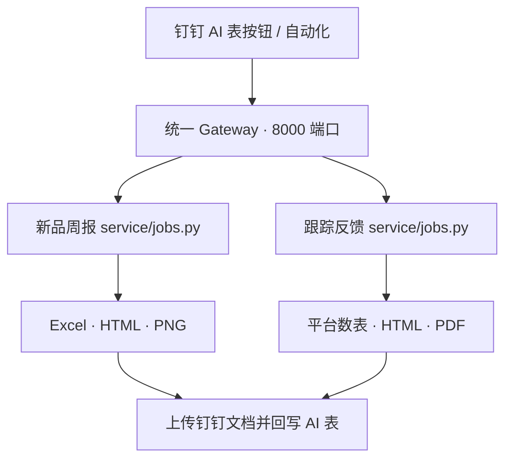
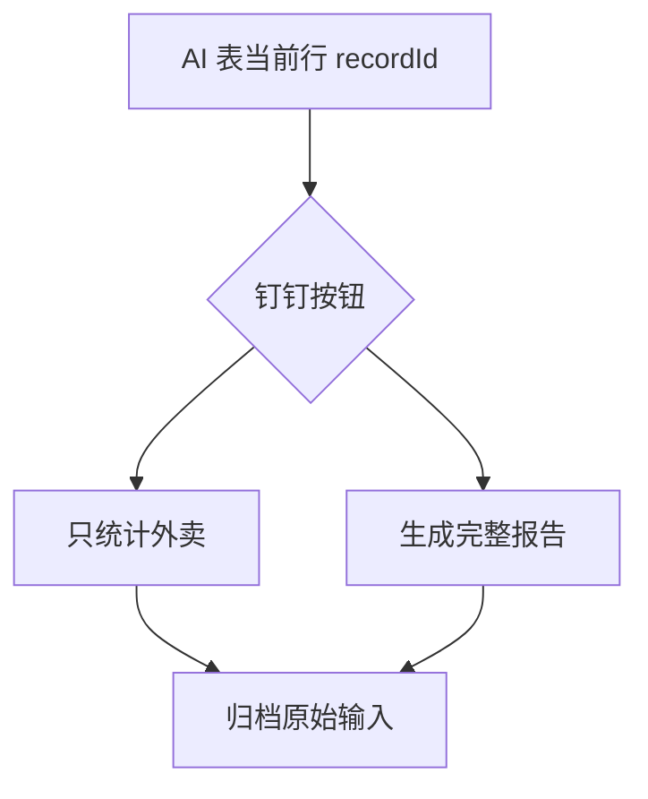

# Competitor Report Suite

竞品报告自动化工具集，包含“竞品新品周报”和“竞品跟踪反馈报告”两个项目。

这份 README 面向项目维护者和实习生，重点说明：

- 两个项目分别负责什么
- 钉钉按钮如何通过 HTTP 调用代码
- 数据如何进入统计和报告
- 修改业务规则或排版时应该查看哪个文件

本文不提供完整安装教程，也暂不展开跟踪反馈报告的本地 Python 调试命令。

## 1. 整体架构



核心设计：

- 两个项目共用根目录的 gateway/app.py 和同一个 8000 端口。
- 钉钉自动化只调用 Gateway，不直接调用子项目的 service/app.py。
- Gateway 根据 HTTP 路径判断任务属于哪个项目，再通过子进程执行对应的 service/jobs.py 函数。
- 使用子进程可以避免两个项目都存在 service Python 包时发生导入冲突。
- 钉钉请求只传当前行 recordId；品牌、产品、日期和附件由任务函数回到 AI 表读取。

## 2. 项目组成

| 目录 | 作用 |
| --- | --- |
| gateway/ | 统一 HTTP 入口和任务分发 |
| new-product-monitor/ | 竞品新品周报：Excel、HTML、PNG |
| product-feedback-report/ | 外卖、社媒统计和跟踪反馈 HTML/PDF |
| 各模块的 outputs/ | 本地命令产生的结果，不是线上任务的数据源 |

### 2.1 新品周报

```text
new-product-monitor/
├── assets/                        # 字体和 Logo
├── config/
│   ├── field_mapping.json         # AI 表字段映射
│   ├── report_rules.json          # 数据与业务规则
│   ├── excel_layout.json          # Excel 排版
│   ├── image_layout.json          # HTML/PNG 排版
│   └── font_files.json            # 字体配置
├── scripts/
│   ├── generate_weekly_report.py  # 数据整理与 Excel
│   ├── generate_weekly_outputs.py # Excel/HTML/PNG 统一入口
│   └── render_report_image.py     # HTML/PNG 渲染
├── service/
│   ├── jobs.py                    # 钉钉周报任务编排
│   ├── dingtalk_table.py          # AI 表读取和回写
│   └── dingtalk_docs.py           # 钉钉文档上传
├── tests/
└── outputs/
```

### 2.2 跟踪反馈报告

```text
product-feedback-report/
├── assets/                        # 字体和 Logo
├── config/
│   ├── field_mapping.json         # AI 表字段映射
│   ├── report_rules.json          # 报告规则
│   ├── platform_rules.json        # 外卖平台规则
│   ├── html_layout.json           # HTML/PDF 排版
│   └── font_files.json            # 字体配置
├── scripts/
│   ├── delivery/
│   │   ├── processing.py          # 外卖读取、合并和指标计算
│   │   └── generate_tables.py     # 美团/饿了么/京东数表
│   ├── social/
│   │   ├── processing.py          # 社媒情感和标签统计
│   │   └── generate_tables.py     # 消费者反馈数表
│   └── reporting/
│       ├── html.py                # 报告内容和样式
│       ├── pdf.py                 # HTML 转 PDF
│       └── generate_report.py     # HTML/PDF 生成
├── service/
│   ├── jobs.py                    # 完整业务流程编排
│   ├── dingtalk_table.py          # AI 表读取和回写
│   ├── dingtalk_docs.py           # 文件夹和文件上传
│   └── schemas.py                 # HTTP 返回结构
├── tests/
└── outputs/
```

## 3. Gateway 和 HTTP 接口

Gateway 统一监听 8000 端口。钉钉通过 ngrok 访问时，所有自动化使用同一个域名，只改变最后的路径。

### 3.1 接口与代码对应关系

| 钉钉动作 | HTTP | Gateway 调用 | 主要业务模块 | 返回方式 |
| --- | --- | --- | --- | --- |
| 生成新品周报 | POST /generate-weekly-report | new-product-monitor/service/jobs.py → run_schedule_job() | scripts/generate_weekly_outputs.py | 异步 |
| 提取产品清单 | POST /prepare-product-menu | product-feedback-report/service/jobs.py → run_prepare_product_menu() | scripts/delivery/prepare_product_menu.py | 异步 |
| 统计外卖数据 | POST /generate-delivery-tables | product-feedback-report/service/jobs.py → run_generate_delivery_tables() | scripts/delivery/generate_tables.py | 异步 |
| 生成完整反馈报告 | POST /generate-report | product-feedback-report/service/jobs.py → run_generate_report() | delivery、social、reporting | 异步 |
| 归档原始文件 | POST /finalize-report | product-feedback-report/service/jobs.py → run_finalize_report() | 钉钉文档上传与字段回写 | 同步 |

Gateway 中仍保留 POST /generate-consumer-feedback 路由，但当前 jobs.py 没有对应任务函数。该接口不属于当前生产流程，不应配置到钉钉自动化；社媒统计由 /generate-report 内部完成。

### 3.2 钉钉 HTTP 请求

HTTP 节点统一使用 POST 和 JSON：

```json
{
  "recordId": "钉钉自动化传入的当前行记录ID"
}
```

recordId 是触发自动化的 AI 表当前行记录 ID，不是品牌名或日期。

### 3.3 HTTP 200 的含义

- /generate-weekly-report、/prepare-product-menu、/generate-delivery-tables、/generate-report：HTTP 200 只表示任务已被接收。最终结果看 AI 表状态和“反馈信息”。
- /finalize-report：同步等待归档结束。HTTP 200 表示上传和字段回写完成；失败返回 HTTP 500。

异步接口通常立即返回：

```json
{
  "ok": true,
  "status": "accepted",
  "recordId": "当前行记录ID",
  "message": "任务已接收。"
}
```

## 4. 新品周报

### 4.1 运行流程

```text
竞品新品周报状态机当前行
→ POST /generate-weekly-report
→ run_schedule_job()
→ 读取业务、开始时间、截止时间、年份、周次
→ generate_weekly_outputs()
→ 生成 Excel、HTML、PNG
→ 上传业务对应的钉钉知识库
→ 回写周报链接、状态、生成时间和反馈信息
```

钉钉 HTTP 任务在系统临时目录生成文件，上传完成后清理；不会在本机 outputs/ 留一份。

### 4.2 周报命令行

以下命令在 new-product-monitor/ 目录运行。

默认生成 Excel、HTML 和 PNG：

```bash
python scripts/generate_weekly_outputs.py
```

常用参数：

| 参数 | 含义 | 示例 |
| --- | --- | --- |
| --startDate | 开始日期，YYYYMMDD | 20260509 |
| --endDate | 截止日期，YYYYMMDD | 20260515 |
| --business | 业务范围 | 喜茶、野萃山、茶坊 |
| --brands | 手动品牌范围，英文逗号分隔 | 霸王茶姬,古茗 |
| --output-mode | all、excel、html、image | image |
| --output-dir | 自定义输出目录 | outputs/test |

指定周期和业务：

```bash
python scripts/generate_weekly_outputs.py \\
  --business 喜茶 \\
  --startDate 20260509 \\
  --endDate 20260515
```

只生成 PNG：

```bash
python scripts/generate_weekly_outputs.py --output-mode image
```

手动指定品牌：

```bash
python scripts/generate_weekly_outputs.py \\
  --brands 霸王茶姬,古茗,乐乐茶
```

--brands 和 --business 同时存在时，以 --brands 为准。不传日期时，按最近一个完整“周六到周五”周期计算。

只生成 Excel：

```bash
python scripts/generate_weekly_report.py \\
  --startDate 20260509 \\
  --endDate 20260515 \\
  --brands 霸王茶姬,古茗
```

本地命令默认写入 new-product-monitor/outputs/。同名结果存在时添加 _2、_3，不覆盖旧结果。

## 5. 跟踪反馈报告



### 5.1 只统计外卖

HTTP：POST /generate-delivery-tables

当前行需要竞品品牌、报告日期和“外卖数据”单个 .xlsx 附件；产品清单Adjusted 可选，关注新品可以为空。

处理过程：

1. run_generate_delivery_tables() 下载外卖附件。
2. 有 Adjusted 时使用人工清单；没有时自动生成本次产品清单。
3. generate_delivery_tables() 分别计算美团、饿了么和京东。
4. 有数据的平台上传统计表并回写链接；无数据平台不上传空表。

这条流程不读取社媒，也不生成最终 HTML/PDF。

### 5.2 生成完整报告

HTTP：POST /generate-report

当前行需要竞品品牌、关注新品、报告日期和外卖附件。社媒附件从匹配到的消费者反馈记录中读取。

run_generate_report() 一次完成：

1. 读取当前行及关联的消费者反馈记录。
2. 下载并校验外卖、社媒原始附件。
3. 读取 Adjusted；为空时自动生成产品清单和近 30 日上新日期。
4. 重新统计美团、饿了么、京东和社媒数据。
5. 上传平台数表和消费者反馈数表。
6. 生成并上传 HTML/PDF，回写 PDF 链接。

完整报告始终从原始附件重新计算，不读取之前由“统计外卖数据”按钮生成的数表。

### 5.3 归档原始输入

HTTP：POST /finalize-report

run_finalize_report() 只归档用户提供的原始输入：

- 外卖原始数据
- 产品清单Adjusted（存在时）
- 社媒CleanedRawData（完整报告任务）

自动产品清单、平台数表、消费者反馈数表、HTML 和 PDF 已在生成步骤上传，不属于原始文件归档范围。

归档判断：

- 有关注新品：归档外卖、Adjusted 和社媒原始数据。
- 无关注新品：按纯外卖任务只归档外卖和 Adjusted。
- 已是钉钉文档链接的字段直接跳过。

## 6. 数据和文件设计

### 原始输入

原始输入是 AI 表中人工上传的 .xlsx：

- 外卖数据
- 产品清单Adjusted
- 社媒CleanedRawData

生成统计表和报告时读取原始附件；只有归档步骤会把原始附件字段替换为钉钉文档链接。

### Auto 和 Adjusted

- 产品清单Auto：代码自动生成，只供下载检查。
- 产品清单Adjusted：人工修正版本；存在时统计优先使用。
- 统计任务不会把历史 Auto 当作下一次运行输入。

### 生成结果

- 新品周报：Excel、HTML、PNG
- 外卖统计：美团、饿了么、京东 Excel
- 社媒统计：消费者反馈 Excel
- 最终报告：HTML、PDF

线上 HTTP 任务主要在临时目录生成，上传后清理。本机 outputs/ 主要用于手动命令和调试。

## 7. 修改代码时从哪里开始

| 要修改的内容 | 主要文件 |
| --- | --- |
| Gateway 路由、端口、HTTP 接收方式 | gateway/app.py |
| 钉钉按钮对应的完整流程 | 各项目 service/jobs.py |
| AI 表字段读取与回写 | service/dingtalk_table.py、config/field_mapping.json |
| 钉钉文档目录和文件上传 | service/dingtalk_docs.py |
| 周报数据筛选和 Excel | new-product-monitor/scripts/generate_weekly_report.py |
| 周报 HTML/PNG | new-product-monitor/scripts/render_report_image.py |
| 外卖合并、销量和门店数 | product-feedback-report/scripts/delivery/processing.py |
| 外卖统计表 | product-feedback-report/scripts/delivery/generate_tables.py |
| 社媒情感、标签和用户数 | product-feedback-report/scripts/social/processing.py |
| 最终报告内容和样式 | product-feedback-report/scripts/reporting/html.py |
| HTML 转 PDF | product-feedback-report/scripts/reporting/pdf.py |
| 版式、字体和业务参数 | 各项目 config/*.json |

修改统计规则时优先看 processing.py；修改钉钉流程时看 service/jobs.py；修改页面外观时看布局配置和渲染文件。

## 8. 常见问题

### HTTP 200 但没有生成文件

多数生成接口是异步任务。HTTP 200 只代表 Gateway 接收成功，应继续查看 AI 表状态、“反馈信息”和 Gateway 终端日志。

### /finalize-report 返回 HTTP 500

归档接口是同步的。查看响应 detail 或终端中从 Traceback 到最后一行的完整错误。

### 钉钉返回“工具调用准备失败，请稍后重试”

错误来自钉钉 AI 表或 MCP 工具准备阶段，不是报告排版代码。可以先重试；持续出现时检查 MCP 服务和 AI 表权限。

### 8000 端口被占用

访问 http://127.0.0.1:8000/health。如果返回 weeklyRoot 和 feedbackRoot，说明已有 Gateway 在运行。

### 外卖统计数量异常

检查 scripts/delivery/processing.py 的分组键、最新日期筛选、同店同产品合并和门店去重规则。门店数按产品口径去重，销量可以合并同店同产品的多条链接。

### 报告缺少社媒内容

确认关注新品能匹配消费者反馈记录，且社媒CleanedRawData 只包含对应产品，并具备代码要求的平台工作表和字段。

### PNG 或 PDF 无法生成

周报 PNG 依赖 Chrome/Playwright；反馈报告 PDF 依赖 Chrome、Chromium 或 Edge 的无头打印。

## 9. 建议阅读顺序

1. 本 README 的整体架构和 HTTP 接口表。
2. gateway/app.py，理解请求如何分发。
3. 对应项目的 service/jobs.py，理解任务顺序。
4. scripts/*/processing.py，理解统计规则。
5. 报告渲染文件，理解最终呈现。

先理解“入口 → 任务编排 → 数据处理 → 输出上传”这条主链路，再阅读配置细节。

## 10. License

本项目为内部专用项目，未授予任何公开开源许可。

仅限经项目所有者授权的内部成员在工作范围内查看和使用。未经项目所有者书面授权，不得复制、修改、分发、公开发布、转授权、销售或用于任何商业用途，也不得将项目代码、配置、数据或生成结果上传至未经批准的外部平台。

Copyright © 2026 cheryl-KXH. All rights reserved.
